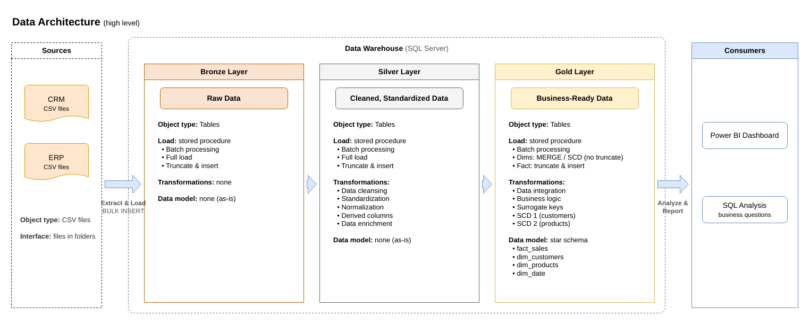
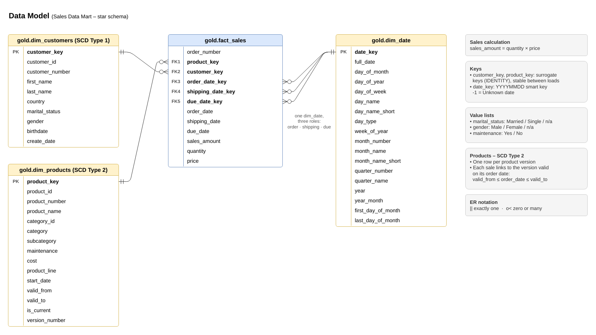

# SQL Data Warehouse: Sales Data Mart

I built a data warehouse in SQL Server that takes raw sales data from two systems (CRM and ERP), cleans it, and turns it into a star schema you can actually analyze.

I started from the [Data With Baraa](https://www.youtube.com/@datawithbaraa) SQL Data Warehouse tutorial, then rebuilt the Gold layer to work more like a real warehouse: it keeps product history, detects changes on its own, and loads everything in one safe transaction. Those changes are listed in [What I added](#what-i-added).

---

## Architecture



The warehouse follows the Medallion architecture, with three layers:

| Layer | What's in it | How it loads |
|---|---|---|
| **Bronze** | Raw data, exactly as it comes from the CSV files | Truncate and insert (`bronze.load_bronze`) |
| **Silver** | Cleaned and standardized data | Truncate and insert (`silver.load_silver`) |
| **Gold** | Business-ready star schema | Stored procedure that keeps history (`gold.load_gold`) |

How data moves from each source table to the final model: [data flow](docs/data_flow.png) · [how the source tables connect](docs/data_intergration.drawio.png)

---

## Data model



- **`fact_sales`**: one row per order line (sales amount, quantity, price)
- **`dim_customers`**: who bought (SCD Type 1)
- **`dim_products`**: what was sold, with every price version (SCD Type 2)
- **`dim_date`**: one row per day, used for order, shipping, and due dates

Full column descriptions are in the [data catalog](docs/data_catalog.md).

---

## What I added

| What | What it does | Why I did it |
|---|---|---|
| **Date dimension** | A calendar table with week, month, quarter, and year, plus an `Unknown` row (-1) for missing dates | To make time analysis easy, and to keep the 19 sales with invalid dates instead of losing them |
| **Gold as tables** | Gold is real tables loaded by `gold.load_gold`, with primary and foreign keys | So keys stay the same between loads, and the warehouse can remember history |
| **SCD Type 2 on products** | Every price change creates a new product version (`valid_from`, `valid_to`, `is_current`) | So a sale from 2012 is measured at the 2012 cost, not today's cost |
| **Change detection** | Each load compares Silver with Gold and opens a new version only when something changed | Real source systems usually overwrite old values, so the warehouse has to track history itself |
| **SCD Type 1 on customers** | Customer changes are applied with `MERGE` | Customer details stay current, with no duplicates |
| **One transaction per load** | If any step fails, the whole Gold load rolls back | Gold is never left half-loaded |

### Decisions I made

- **Gender**: the CRM is the main source. The ERP value is only used when the CRM has none.
- **First product version starts at 1900-01-01.** About 30% of sales happened before their product's first recorded start date (the source uses July 1 fiscal-year dates). Without this, those sales wouldn't match any product.
- **What counts as a change**: name, category, maintenance, cost, or product line. I compare them with `EXISTS (... EXCEPT ...)`, which also catches a NULL changing to a value (a plain `<>` misses that).

---

## How SCD Type 2 works here

Example: one helmet, `HL-U509-R`, after a price change.

| product_key | cost | valid_from | valid_to | is_current |
|---|---|---|---|---|
| 68 | 12 | 1900-01-01 | 2012-06-30 | 0 |
| 171 | 14 | 2012-07-01 | 2013-06-30 | 0 |
| 348 | 13 | 2013-07-01 | 2026-10-31 | 0 |
| 398 | 23 | 2026-11-01 | 9999-12-31 | 1 |

On every load:
1. **Compare** the product's current row in Silver with its `is_current = 1` version in Gold.
2. If something changed, **close** the old version (`valid_to` = the day before the load).
3. **Open** a new version (`valid_from` = the load date).

Each sale links to the version where `valid_from ≤ order_date ≤ valid_to`.

To see it happen step by step, run [`tests/test_scd2_products.sql`](tests/test_scd2_products.sql).

---

## How to run it

**You need:** SQL Server (Express works) and SQL Server Management Studio (SSMS).

1. Run `scripts/init_database.sql` to create the `DataWarehouse` database and its schemas.
2. Bronze: run `scripts/bronze/ddl_bronze.sql`, then `scripts/bronze/proc_load_bronze.sql`.
   - Update the CSV file paths in `proc_load_bronze.sql` to where you saved `datasets/`.
   - Then run `EXEC bronze.load_bronze;`
3. Silver: run `scripts/silver/ddl_silver.sql` and `scripts/silver/proc_load_silver.sql`, then `EXEC silver.load_silver;`
4. Gold: run `scripts/gold/ddl_gold.sql` and `scripts/gold/proc_load_gold.sql`, then `EXEC gold.load_gold;`
5. Check the results with `tests/quality_checks_silver.sql` and `tests/quality_checks_gold.sql`. Each check says what result to expect.

After the first setup, a normal reload is just the three `EXEC` lines in order: Bronze, Silver, Gold.

> `ddl_gold.sql` recreates the Gold tables, which also deletes the product history. Only run it for setup.

---

## Repository structure

```
sql-data-warehouse-project/
├── datasets/
│   ├── source_crm/                 # customers, products, sales
│   └── source_erp/                 # extra customer info, locations, product categories
├── docs/
│   ├── data_architecture.png       # the layers
│   ├── data_flow.png               # how each table moves through the layers
│   ├── data_intergration.drawio.png  # how the source tables connect
│   ├── data_model.png              # the star schema
│   ├── ETL.png                     # ETL methods used in this project
│   ├── data_catalog.md             # every Gold column explained
│   └── naming_conventions.md
├── scripts/
│   ├── init_database.sql
│   ├── bronze/                     # raw load
│   ├── silver/                     # cleaning
│   └── gold/                       # star schema tables + load procedure
├── tests/
│   ├── quality_checks_silver.sql
│   ├── quality_checks_gold.sql
│   └── test_scd2_products.sql      # SCD Type 2 demo
├── LICENSE
└── README.md
```

All diagrams are draw.io files saved as PNG. Open them in [draw.io](https://www.drawio.com/) to edit.

---

## What I learned

- Why a warehouse is split into layers, and what each layer is responsible for
- Building a star schema: facts vs. dimensions, surrogate keys, role-playing dimensions
- The difference between SCD Type 1 and Type 2, and how to detect changes without help from the source
- Writing load procedures that are safe to rerun, using transactions and quality checks

---

## Credits

- **Original project and dataset**: the [Data With Baraa](https://www.youtube.com/@datawithbaraa) SQL Data Warehouse tutorial.
- **My extensions**: I chose what to add beyond the tutorial (date dimension, Gold as tables, SCD Type 2, change detection) and the design decisions listed above.
- **AI assistance**: I used [Claude](https://claude.ai) (Anthropic) as an assistant to help write and review the Gold layer SQL, organize the repository, write the documentation, and draw the diagrams.

## About me

I'm a business analytics student who enjoys the practical analytical side of data: figuring out how the numbers fit together and making them reliable enough to make decisions with. 

## License

MIT License. See [LICENSE](LICENSE).
